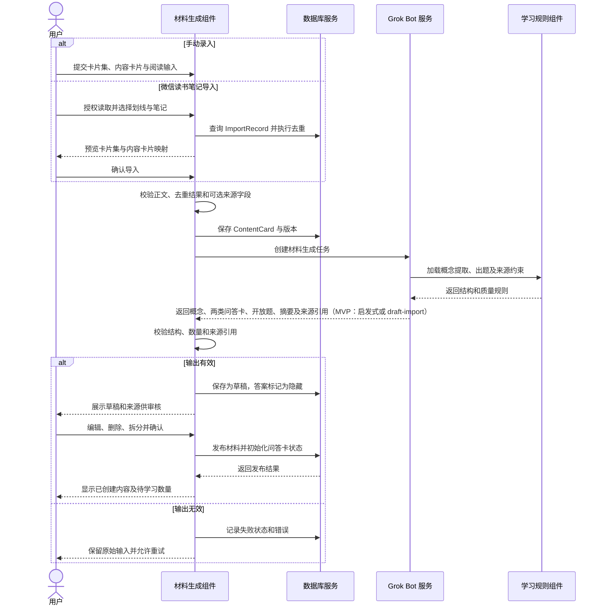
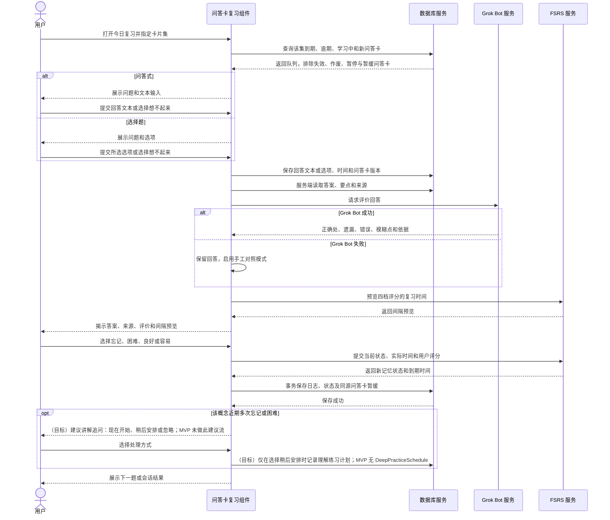
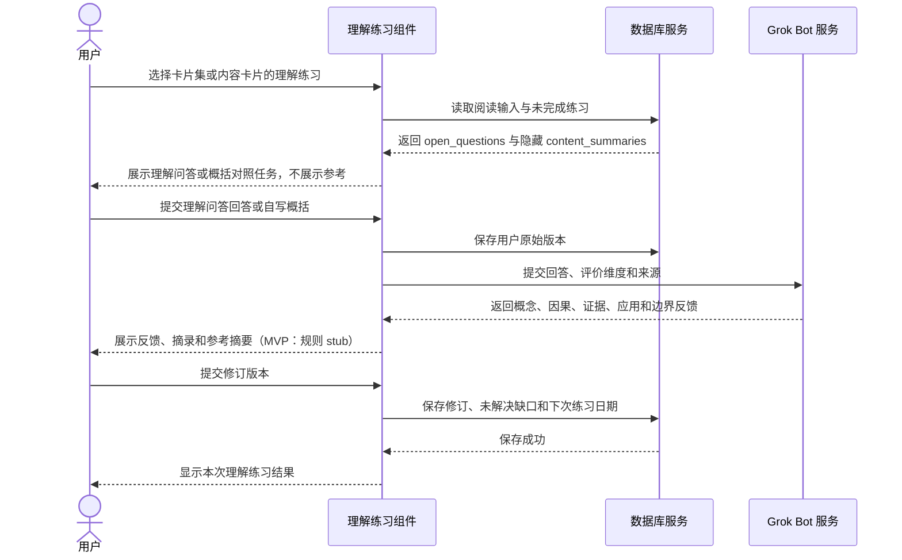
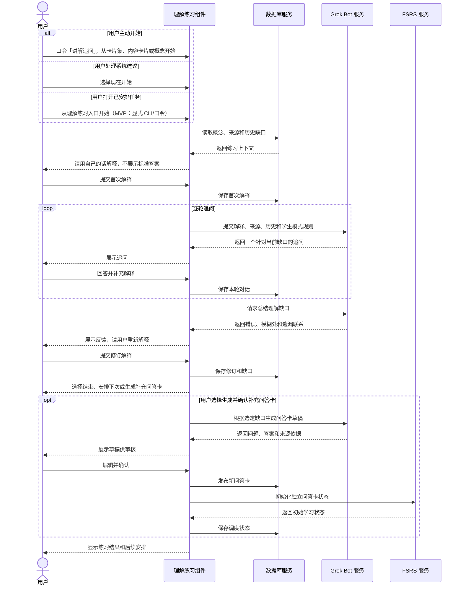
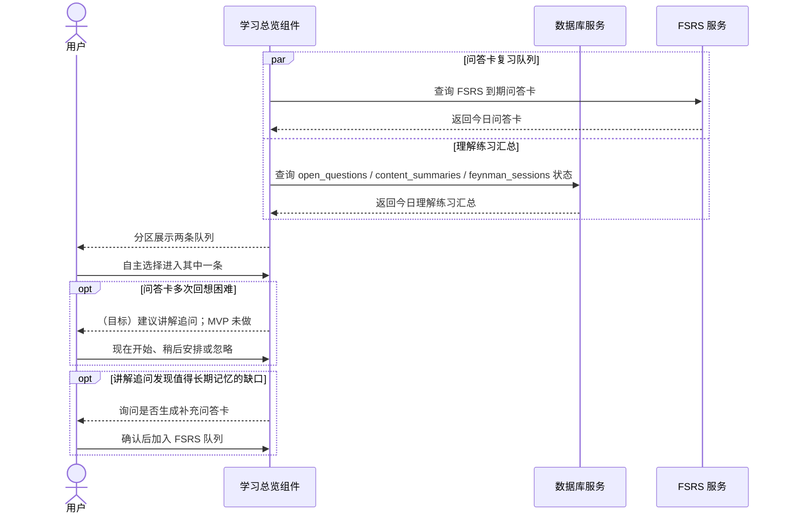
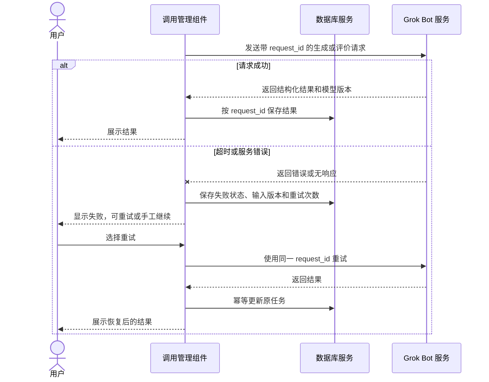

# 系统时序

## 1. 阅读材料生成与发布

## 2. 主动回想与 FSRS 调度

> 注：开场须先选集；通知服务为产品能力，MVP 默认关闭 learning 短间隔推送（见规则 20、22）。

## 3. 概括对照与理解问答

## 4. 可选讲解追问与薄弱点回流

## 5. 两条独立队列及可选连接

## 6. Grok Bot 调用失败与恢复

## 完整图表

- [SVG](../../diagrams/grok-active-reading/system-sequence.svg)
- [PNG](../../diagrams/grok-active-reading/system-sequence@2x.png)

